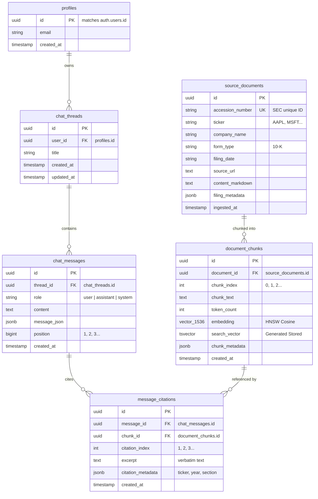

# Document Copilot — Project Understanding & Interview Guide

> **Target Audience:** Engineering candidate preparing for Software Engineering / Backend / AI-ML technical interviews.  
> **Source Repository:** `DCopilot` (Document Copilot)  
> **Target Role:** Full-Stack / Backend / Applied AI Engineer

---

## 1. One-Line Pitch and 30-Second Explanation

### The One-Line Pitch
> *"Document Copilot is an AI-powered financial research assistant that enables investment analysts to query SEC 10-K filings with guaranteed factual grounding and interactive, verifiable citations down to the exact source passage."*

### The 30-Second Interview Explanation
> *"Financial analysts spend dozens of hours every quarter reading 100+ page SEC 10-K and 10-Q reports to extract key financial metrics, risk factors, and segment revenue breakdowns. Standard LLMs hallucinate numbers or cite stale web data, which is completely unacceptable in finance.*  
>  
> *I built Document Copilot as an end-to-end system that solves this. It downloads and ingests audited SEC filings, parses them into section-aware chunks, and indexes them in Supabase Postgres using hybrid retrieval—combining dense vector semantic search via `pgvector` with lexical BM25 full-text search fused through Reciprocal Rank Fusion (RRF).*  
>  
> *When an analyst asks a question, a PydanticAI agent orchestrates tool calls against the hybrid index, synthesizes answers strictly from retrieved evidence, and passes the output through a deterministic Grounding Validator. The React SPA renders the answer with interactive bracketed citations `[1]` that slide open an inspection drawer showing the exact verbatim SEC passage and EDGAR source URL."*

---

## 2. Tech Stack Table

| Layer / Component | Technology Selected | Why It Fits This Project | Realistic Alternative & Why Not Chosen |
|---|---|---|---|
| **Backend Framework** | **Python 3.12 + FastAPI** | Fast execution, native async IO, tight integration with Pydantic v2 and Python's AI/retrieval ecosystem. | **Node.js / Express**: Lacks rich numerical and document parsing libraries (XBRL, tokenizers, vector math). |
| **Package & Env Manager**| **Astral `uv`** | 10–100x faster dependency resolution than `pip`/`poetry`, deterministic lockfile (`uv.lock`), native workspace and script execution. | **Poetry / Pipenv**: Significantly slower virtual environment creation and resolution in CI/Docker. |
| **Agent Framework** | **PydanticAI** | Type-safe LLM orchestration with native Pydantic validation, explicit dependency injection (`RunContext`), and structured outputs. | **LangChain / CrewAI**: Heavyweight abstractions, frequent breaking changes, difficult to debug in production. |
| **LLM & Embeddings** | **OpenRouter API (`openrouter/free` + `text-embedding-3-small`)** | OpenAI SDK compatibility; provides high-quality free chat models and 1536-dimension embeddings within pgvector limits. | **Direct OpenAI API / Anthropic**: Requires paid credits per developer; OpenRouter allows flexible model routing. |
| **Database & Vector Store**| **Supabase Postgres + `pgvector`** | Single data plane for relational tables, user auth, JSONB metadata, full-text search (`tsvector`), and cosine vector indexing (`vector(1536)`). | **Pinecone / Qdrant + DynamoDB**: Two separate database systems create distributed transaction and sync headaches. |
| **Database Migrations** | **Alembic + SQLAlchemy 2.0** | Declarative Python models with explicit, version-controlled DDL migrations for complex PostgreSQL types (HNSW indexes, generated tsvectors). | **Supabase CLI raw SQL**: Harder to unit-test models in-memory or maintain cross-environment reproducibility. |
| **Authentication** | **Supabase Auth (JWT via Bearer)** | Secure, production-ready email auth with built-in token issuance, session refresh, and PostgreSQL Row-Level Security (RLS) integration. | **Custom Auth (FastAPI-Users / Authlib)**: Requires building password hashing, reset emails, and token rotation from scratch. |
| **Frontend Framework** | **Vite + React 18 + TypeScript** | Lean Single-Page Application (SPA) with fast HMR, strict type checking, and clean separation from the backend API. | **Next.js (App Router)**: Unnecessary Node server runtime for an internal enterprise dashboard where FastAPI already owns the backend. |
| **Styling & Icons** | **Tailwind CSS v4 + Lucide React** | Utility-first styling with zero runtime CSS overhead, dark-mode financial terminal palette, and clear iconography. | **MUI / Ant Design**: Heavy bundle footprint, rigid theming, and difficult custom CSS overrides. |
| **Deployment / Hosting** | **Railway (Docker multi-stage)** | Simple Git-driven container hosting with dynamic `$PORT` binding, automated health checks, and unified project namespaces. | **AWS ECS / EKS**: Over-engineered for an internal tool; massive configuration and DevOps overhead. |

---

## 3. Architecture Overview

### High-Level Service Architecture

```
                                  +------------------------------------+
                                  |         Investment Analyst         |
                                  |         (Browser / Client)         |
                                  +-----------------+------------------+
                                                    |
                                      HTTPS (SPA)   |   Bearer JWT
                                                    v
                                  +------------------------------------+
                                  |      Frontend (Vite + React)       |
                                  |   Nginx Alpine Container (:80)     |
                                  +-----------------+------------------+
                                                    |
                                       REST API     |   Authorization: Bearer <token>
                                                    v
                                  +------------------------------------+
                                  |     Backend (FastAPI + Uvicorn)    |
                                  |    Python 3.12 Container (:8000)   |
                                  +--------+------------------+--------+
                                           |                  |
                       SQLAlchemy / Psycopg|                  | Tool Calls
                                           v                  v
    +-----------------------------------------------+   +----------------------------------+
    |           Supabase Managed Platform           |   |       OpenRouter API Gateway     |
    |                                               |   +-----------------+----------------+
    |  +------------------+  +-------------------+  |                     |
    |  |  Supabase Auth   |  | Postgres Database |  |                     | OpenAI SDK
    |  |  (JWT Verify)    |  |  (pgvector + FTS) |  |                     v
    |  +------------------+  +-------------------+  |   +----------------------------------+
    |                        | - chat_threads    |  |   | Chat Model: openrouter/free      |
    |                        | - chat_messages   |  |   | Embeddings: text-embedding-3-sm  |
    |                        | - source_documents|  |   +----------------------------------+
    |                        | - document_chunks |  |
    |                        | - message_citation|  |
    |                        +-------------------+  |
    +-----------------------------------------------+
```

### Component Interaction Flow

1. **Client Tier (`frontend/`):** React SPA renders the interactive research terminal. Upon user sign-in via Supabase Auth, client captures a JWT access token and attaches it to every outbound HTTP call in [src/lib/http.ts](file:///Users/abhisuryawanshi/DCopilot/frontend/src/lib/http.ts).
2. **Gateway & Auth Tier (`backend/app/auth/`):** FastAPI intercepts the request. The dependency [get_current_user](file:///Users/abhisuryawanshi/DCopilot/backend/app/auth/dependencies.py#L20) verifies the JWT with Supabase Auth, retrieves `user_id`, and ensures a synced record exists in the local `profiles` table.
3. **Orchestration Tier (`backend/app/chat/orchestrator.py`):** Coordinates state persistence and agent execution. It writes the user's question to `chat_messages`, instantiates the retriever with a scoped database session, and runs the agent.
4. **Agent Tier (`backend/app/assistant/agent.py`):** The PydanticAI `document_agent` evaluates the question. If information is required, it invokes the tool `search_sec_filings`.
5. **Hybrid Retrieval Tier (`backend/app/retrieval/retriever.py`):** Generates an embedding vector for the search query, runs dense cosine similarity via `pgvector` and lexical full-text search via PostgreSQL `tsvector`, and merges results using Reciprocal Rank Fusion (RRF).
6. **Grounding Validation Tier (`backend/app/grounding/validator.py`):** Deterministically parses all inline `[N]` citation badges in the generated answer, verifies they match retrieved passages, and links real database UUIDs to `message_citations`.
7. **Persistence Tier (`backend/app/database/`):** Assistant message and resolved citation metadata are committed to Supabase Postgres.

---

## 4. Folder and File Map

```text
DCopilot/
├── AGENTS.md                                # Master instructions and conventions for coding agents
├── README.md                                # Project overview, quickstart, and documentation links
├── PROJECT_UNDERSTANDING.md                 # This guide — complete architecture and interview defense
├── data/
│   ├── download.py                          # SEC EDGAR standalone download script (AAPL, MSFT, NVDA, AMZN, GOOGL)
│   └── downloads/
│       └── manifest.json                    # Index of downloaded 10-K HTML filings with accession numbers
├── docs/
│   ├── architecture.md                      # Detailed technical specification and target architecture
│   ├── client-brief.md                      # Problem brief for Driftwood Capital investment analysts
│   └── guides/
│       ├── backend-setup.md                 # Backend environment setup notes
│       ├── frontend-setup.md                # Frontend development notes
│       ├── supabase-setup.md                # Supabase schema, keys, and RLS notes
│       └── deployment.md                    # Complete production deployment runbook for Railway
├── backend/
│   ├── pyproject.toml                       # Python package configuration, dependencies, and pytest settings
│   ├── uv.lock                              # Pinned, deterministic dependency lockfile
│   ├── alembic.ini                          # Alembic migration configuration
│   ├── Dockerfile                           # Production multi-stage Dockerfile for FastAPI + uv
│   ├── .dockerignore                        # Docker build exclusion list
│   ├── alembic/
│   │   ├── env.py                           # Alembic environment importing models and settings.database_url
│   │   └── versions/
│   │       ├── 001_initial_schema.py        # ★ CORE: Initial schema (6 tables, pgvector, HNSW, tsvector)
│   │       └── 002_rls_policies.py          # ★ CORE: 14 Postgres Row-Level Security policies
│   ├── app/
│   │   ├── config.py                        # ★ CORE: Pydantic Settings — single source of truth for env vars
│   │   ├── main.py                          # FastAPI ASGI app entrypoint, CORS, and /health probe
│   │   ├── api/
│   │   │   ├── schemas.py                   # Pydantic request/response schemas for threads and messages
│   │   │   └── threads.py                   # REST endpoints: GET/POST/PATCH/DELETE threads & messages
│   │   ├── auth/
│   │   │   ├── dependencies.py              # ★ CORE: Supabase JWT validation & user profile synchronization
│   │   │   └── schemas.py                   # AuthenticatedUser schema
│   │   ├── chat/
│   │   │   └── orchestrator.py              # ★ CORE: Turn execution pipeline (persist -> agent -> validate -> store)
│   │   ├── assistant/
│   │   │   ├── agent.py                     # ★ CORE: PydanticAI document_agent definition & search tool
│   │   │   ├── deps.py                      # DocumentAgentDeps runtime dependency injection container
│   │   │   ├── instructions.py              # System prompt enforcing grounding and strict refusal rules
│   │   │   └── outputs.py                   # GroundedAnswer and CitationReference output schemas
│   │   ├── retrieval/
│   │   │   ├── fusion.py                    # ★ CORE: Reciprocal Rank Fusion (RRF) algorithm implementation
│   │   │   ├── queries.py                   # Raw pgvector cosine distance (<=>) and FTS (websearch_to_tsquery)
│   │   │   ├── retriever.py                 # DocumentRetriever coordinator executing hybrid search
│   │   │   └── schemas.py                   # RetrievalFilter and SourcePassage schemas
│   │   ├── grounding/
│   │   │   └── validator.py                 # ★ CORE: Citation integrity validator and hallucination detector
│   │   ├── ingest/
│   │   │   ├── parser.py                    # SECHTMLParser (stdlib) stripping XBRL/HTML and extracting Items
│   │   │   ├── chunker.py                   # DocumentChunker splitting text into 500-token section-aware chunks
│   │   │   ├── embedder.py                  # Batch embedding generator with retries and dimension verification
│   │   │   ├── loader.py                    # Manifest loader and filing processor
│   │   │   └── schemas.py                   # ParsedDocument and ChunkData schemas
│   │   └── database/
│   │       ├── models.py                    # ★ CORE: SQLAlchemy models for all 6 database tables
│   │       ├── session.py                   # Database engine, connection pool, and get_db session dependency
│   │       ├── chats.py                     # Thread, message, and citation CRUD operations
│   │       ├── documents.py                 # Document and chunk upsert and counting helpers
│   │       └── supabase.py                  # Async Supabase client constructors (anon & service-role)
│   ├── ingest/
│   │   └── ingest_corpus.py                 # CLI tool to batch parse, chunk, embed, and store SEC filings
│   ├── evals/
│   │   └── grounding_eval.py                # Live end-to-end evaluation script (factual, comparative, refusal)
│   └── tests/                               # 44 unit and invariant tests (100% passing)
│       ├── test_config.py                   # Configuration and conservative limit tests
│       ├── test_auth.py                     # JWT validation, 401 unauthorized, and bearer parsing tests
│       ├── test_ingest.py                   # HTML parser, section splitter, and chunker tests
│       ├── test_embedder.py                 # Embedding batching and dimension verification tests
│       ├── test_fusion.py                   # Reciprocal Rank Fusion mathematical property tests
│       ├── test_retriever.py                # Hybrid search and citation header formatting tests
│       ├── test_agent.py                    # Tool calling and passage accumulation tests
│       ├── test_grounding.py                # Grounding validator and out-of-bounds citation tests
│       ├── test_quality_grounding.py        # Anti-hallucination and multi-firm attribution tests
│       ├── test_threads.py                  # Thread and message CRUD, RLS isolation tests
│       └── test_main.py                     # Liveness and healthcheck tests
└── frontend/
    ├── package.json                         # Node dependencies (React 18, Tailwind v4, Lucide, Supabase)
    ├── pnpm-lock.yaml                       # Pinned pnpm lockfile
    ├── pnpm-workspace.yaml                  # pnpm build permissions (esbuild allowed)
    ├── vite.config.ts                       # Vite configuration with @/* path aliases and Tailwind plugin
    ├── tsconfig.json                        # Strict TypeScript compiler options
    ├── Dockerfile                           # Multi-stage Dockerfile (node:20-slim build -> nginx:alpine)
    ├── nginx.conf.template                  # Nginx configuration with SPA fallback routing and dynamic $PORT
    ├── src/
    │   ├── main.tsx                         # React DOM mount point
    │   ├── App.tsx                          # Auth state listener and top-level router
    │   ├── index.css                        # Tailwind directives and custom scrollbar styling
    │   ├── lib/
    │   │   ├── env.ts                       # ★ CORE: Fail-fast frontend environment variable validation
    │   │   ├── supabase.ts                  # Supabase browser client singleton
    │   │   ├── http.ts                      # ★ CORE: Native fetch client with auto Bearer JWT injection
    │   │   ├── api.ts                       # Typed API methods for threads and chat messages
    │   │   ├── types.ts                     # TypeScript models for Threads, Messages, and Citations
    │   │   └── utils.ts                     # Tailwind class merge (clsx + twMerge) and date formatting
    │   ├── components/
    │   │   ├── layout/Navbar.tsx            # Header bar with Driftwood Capital brand and sign-out button
    │   │   └── chat/
    │   │       ├── Sidebar.tsx              # Research history list, New Thread button, delete action
    │   │       ├── ChatPane.tsx             # ★ CORE: Message list, interactive [N] badges, query composer
    │   │       └── CitationDrawer.tsx       # ★ CORE: Slide-out drawer showing verbatim excerpt & EDGAR link
    │   └── pages/
    │       ├── AuthPage.tsx                 # Supabase email sign-in and sign-up card
    │       └── ChatPage.tsx                 # Main analyst workstation layout coordinating state
```

---

## 5. End-to-End Flow Walkthrough

### Flow 1: Asking an Analyst Research Question
*Example query:* **"What was Apple's total net sales in fiscal 2025, and what were Products vs Services sales?"**

```
[Browser: ChatPane.tsx]
      |  (User types query & presses Enter)
      |  Optimistic message displayed in UI
      v
[Frontend API: api.ts -> http.ts]
      |  Retrieves active session token from Supabase client
      |  Sends HTTP POST /api/threads/{thread_id}/messages
      |  Header: Authorization: Bearer <supabase_jwt>
      v
[FastAPI Entrypoint: backend/app/api/threads.py]
      |  Dependency: get_current_user (backend/app/auth/dependencies.py)
      |    - Calls supabase.auth.get_user(token)
      |    - Ensures user profile exists in local `profiles` table
      |  Invokes: execute_chat_turn(...)
      v
[Orchestrator: backend/app/chat/orchestrator.py]
      |  1. Persists user query to `chat_messages` (role="user")
      |  2. Injects DocumentAgentDeps(user_id, thread_id, retriever)
      |  3. Calls document_agent.run(clean_content, deps=deps)
      v
[PydanticAI Agent: backend/app/assistant/agent.py]
      |  Model evaluates query and instructions
      |  Decides to call tool: search_sec_filings(query="Apple total net sales 2025", ticker="AAPL")
      v
[Hybrid Retriever: backend/app/retrieval/retriever.py]
      |  1. Dense Embedding: calls OpenRouter for 1536-dim vector of query text
      |  2. Semantic Search: runs pgvector cosine distance (<=>) in `document_chunks`
      |  3. Lexical Search: runs PostgreSQL `websearch_to_tsquery` on `search_vector`
      |  4. Fusion: executes Reciprocal Rank Fusion (fusion.py) to merge and rank results
      |  5. Returns top 8 SourcePassage instances formatted with citation headers:
      |     "[1] AAPL 10-K (2025-10-31) | Item 7. MD&A..."
      v
[Agent Synthesis: backend/app/assistant/agent.py]
      |  Agent reads passages and generates answer referencing bracketed citations:
      |  "Apple's total net sales in fiscal 2025 were $416,161 million [1]..."
      v
[Grounding Validator: backend/app/grounding/validator.py]
      |  1. Scans answer text with regex r"\[(\d+)\]" -> finds indices [1], [2], etc.
      |  2. Verifies every index is within bounds of retrieved passages
      |  3. Links real chunk_id UUID, ticker, filing_date, and verbatim excerpt
      v
[Orchestrator Persistence: backend/app/chat/orchestrator.py]
      |  1. Inserts assistant turn into `chat_messages` (role="assistant")
      |  2. Inserts resolved citation records into `message_citations` table
      |  3. Returns serialized MessageResponse to client
      v
[Frontend Rendering: ChatPane.tsx & CitationDrawer.tsx]
      |  ChatPane parses [1] tokens into styled interactive badges
      |  User clicks badge [1] -> opens CitationDrawer.tsx
      |  Displays: Ticker (AAPL), FY (2025), Section (Item 7), Verbatim Excerpt, and Link to SEC EDGAR
```

### Flow 2: SEC Filing Ingestion (Offline / Pre-computation)
*CLI execution:* `uv run ingest/ingest_corpus.py --ticker AAPL --limit 1`

```
[CLI: backend/ingest/ingest_corpus.py]
      |  Loads filing entry from data/downloads/manifest.json
      v
[Loader & Parser: backend/app/ingest/loader.py & parser.py]
      |  SECHTMLParser strips scripts, styling, and inline XBRL tags
      |  Preserves table rows and converts headers to Markdown
      |  split_into_sections detects standard 10-K Items (Item 1, Item 1A, Item 7, Item 8...)
      v
[Chunker: backend/app/ingest/chunker.py]
      |  DocumentChunker splits sections into ~500-token chunks with 75-token overlap
      |  Preserves section context: chunks never bleed across Item boundaries
      |  Attaches metadata: ticker, form_type, filing_date, section_name, accession_number
      v
[Embedder: backend/app/ingest/embedder.py]
      |  Batches chunks into groups of 32
      |  Calls OpenRouter / OpenAI API: model="text-embedding-3-small", dimensions=1536
      |  Validates exact 1536 vector dimension per chunk
      v
[Database Storage: backend/app/database/documents.py]
      |  1. Upserts `source_documents` row (keyed by accession_number)
      |  2. Deletes old chunks for document (idempotent re-ingestion)
      |  3. Inserts `document_chunks` rows with embedding vectors
      |     (Postgres automatically calculates `search_vector` tsvector via GENERATED STORED)
```

---

## 6. Core Concepts I Must Understand

### 1. Hybrid Retrieval and Reciprocal Rank Fusion (RRF)
- **What it is:** Dense retrieval (embeddings) understands *semantic meaning* (e.g. matching "revenue" with "net sales" or "turnover"), but struggles with specific numbers, acronyms, or proper nouns (e.g., "Item 9C" or "Note 14"). Lexical retrieval (BM25 / full-text search) finds *exact keywords* but misses synonyms. Hybrid retrieval executes both and fuses them.
- **Where it appears:** [backend/app/retrieval/fusion.py](file:///Users/abhisuryawanshi/DCopilot/backend/app/retrieval/fusion.py) and [backend/app/retrieval/retriever.py](file:///Users/abhisuryawanshi/DCopilot/backend/app/retrieval/retriever.py).
- **How it works under the hood:** RRF is an algebraic ranking algorithm. Given $M$ ranked candidate lists, the score of document $d$ is:
  $$\text{RRF}(d) = \sum_{m \in M} \frac{w_m}{k + \text{rank}_m(d)}$$
  Where $k$ is a smoothing constant (standard is $60$) preventing top-ranked items from drowning out items that appear across multiple lists. If an SEC passage is ranked #2 in semantic search and #3 in keyword search, its score is boosted significantly higher than a passage appearing in only one list.

### 2. pgvector and HNSW Indexing
- **What it is:** `pgvector` is a PostgreSQL extension that stores mathematical vector embeddings as native column types (`vector(N)`) and enables nearest-neighbor similarity searches using SQL operators.
- **Where it appears:** [alembic/versions/001_initial_schema.py:184-188](file:///Users/abhisuryawanshi/DCopilot/backend/alembic/versions/001_initial_schema.py#L184-L188) and [app/retrieval/queries.py:41](file:///Users/abhisuryawanshi/DCopilot/backend/app/retrieval/queries.py#L41).
- **How it works under the hood:**
  - Cosine distance operator `<=>` computes:
    $$\text{distance}(u, v) = 1 - \frac{u \cdot v}{\|u\|_2 \|v\|_2}$$
  - **HNSW (Hierarchical Navigable Small World):** Instead of calculating distance against every chunk in the database ($O(N)$ sequential scan), HNSW constructs a multi-layer graph where upper layers have long-range skips and lower layers have dense local clustering. Search runs in $O(\log N)$ time.
  - *Hard Constraint:* PostgreSQL pgvector HNSW indexes enforce an absolute maximum of **2,000 dimensions**. This is why `openai/text-embedding-3-small` (1536 dims) was selected instead of 2048- or 4096-dim models.

### 3. PostgreSQL Generated Stored Columns & Full-Text Search
- **What it is:** A database column whose value is automatically computed from other columns upon `INSERT` or `UPDATE` and physically persisted to disk.
- **Where it appears:** [001_initial_schema.py:192-200](file:///Users/abhisuryawanshi/DCopilot/backend/alembic/versions/001_initial_schema.py#L192-L200) and [backend/app/database/models.py:270](file:///Users/abhisuryawanshi/DCopilot/backend/app/database/models.py#L270).
- **How it works under the hood:**
  ```sql
  ALTER TABLE document_chunks
  ADD COLUMN search_vector tsvector
  GENERATED ALWAYS AS (to_tsvector('english', coalesce(chunk_text, ''))) STORED;
  ```
  Postgres automatically parses English words, stems them (e.g. "operating" &rarr; `'oper'`), strips stop words, and stores token lexemes. Because Postgres strictly forbids manual inserts into generated columns, SQLAlchemy models must declare `server_default=FetchedValue()` so the column is omitted from raw `INSERT` statements.

### 4. Row-Level Security (RLS) & Multi-Tenancy
- **What it is:** A PostgreSQL security feature where the database engine itself enforces record-level isolation policies. Even if application code executes `SELECT * FROM chat_threads`, Postgres automatically injects a `WHERE user_id = auth.uid()` filter.
- **Where it appears:** [alembic/versions/002_rls_policies.py](file:///Users/abhisuryawanshi/DCopilot/backend/alembic/versions/002_rls_policies.py).
- **How it works under the hood:**
  14 granular SQL policies isolate user data:
  - `chat_threads`: Users can only SELECT, INSERT, UPDATE, DELETE rows where `user_id = auth.uid()`.
  - `chat_messages` & `message_citations`: Subquery checks ensure messages belong to a thread owned by `auth.uid()`.
  - `source_documents` & `document_chunks`: Read-only access (`SELECT`) granted to all authenticated users; writes require the backend service-role key.

### 5. Grounding & Deterministic Verification
- **What it is:** Preventing generative AI hallucinations by requiring every factual assertion to cite retrieved evidence, and validating those citations deterministically in Python code before saving or displaying them.
- **Where it appears:** [backend/app/grounding/validator.py](file:///Users/abhisuryawanshi/DCopilot/backend/app/grounding/validator.py).
- **How it works under the hood:**
  The LLM produces text with bracketed tokens like `[1]`. The validator:
  1. Uses regex `r"\[(\d+)\]"` to extract all citation numbers from the text.
  2. Compares numbers against the list of passages retrieved during tool execution.
  3. If an index exceeds the count of retrieved passages (e.g. citing `[5]` when only 3 passages were fetched), it marks the answer invalid and flags the ungrounded claim.
  4. Resolves the real `chunk_id` UUID from the database, creating permanent auditability.

---

## 7. Key Design Decisions and Trade-Offs

### 1. Supabase Postgres as Unified Data Plane vs. Dedicated Vector Database (Pinecone/Milvus)
- **Decision:** Use Supabase PostgreSQL for everything (relational user state, vector embeddings via `pgvector`, and lexical search via `tsvector`).
- **Why:** Zero distributed state divergence. A chat thread, message, citation, and vector chunk can be joined in a single ACID transaction. No syncing pipelines between Postgres and a separate vector DB.
- **Downside:** HNSW index building consumes Postgres CPU and RAM.
- **At Scale (100M+ chunks):** Dedicated vector databases or sharded pgvector read-replicas become necessary as index memory requirements exceed unified database cache sizes.

### 2. Pre-chunking with Section Awareness vs. Arbitrary Fixed-Window Splitting
- **Decision:** Split filings along official SEC "Item" boundaries (e.g. Item 1: Business, Item 1A: Risk Factors, Item 7: MD&A, Item 8: Financial Statements) before chunking with 75-token overlap.
- **Why:** Avoids "context pollution". A chunk discussing supply chain risks in Item 1A should never bleed into the financial statement footnote tables in Item 8.
- **Downside:** SEC filings vary widely in HTML formatting, requiring robust regex matching.
- **At Scale:** Ingest XBRL structured XML directly from EDGAR for pre-tagged financial tables, falling back to HTML parsing only for textual narrative sections.

### 3. PydanticAI Agent vs. LangChain / LlamaIndex
- **Decision:** Use PydanticAI for agent orchestration.
- **Why:** Strict type safety, clean dependency injection (`RunContext[DocumentAgentDeps]`), and deterministic Pydantic schema validation. LangChain introduces massive dependency graphs and brittle abstractions.
- **Downside:** PydanticAI is newer, with smaller community forums.
- **At Scale:** Write custom state machines (like LangGraph or custom async DAG runners) when complex multi-agent workflows with human-in-the-loop approvals are required.

### 4. Reciprocal Rank Fusion (RRF) vs. Cross-Encoder Re-ranking
- **Decision:** Use mathematical RRF ($k=60$) in Python to fuse dense and sparse search results.
- **Why:** Extremely fast (sub-millisecond execution), zero external API cost, and mathematically robust across disparate score distributions (cosine similarity vs. ts_rank).
- **Downside:** RRF does not perform cross-attention between query and passage tokens.
- **At Scale:** Add a local or hosted cross-encoder re-ranking model (e.g. `bge-reranker-large` or Cohere Rerank) to score the top 20 RRF candidates before prompting the LLM.

### 5. Native `fetch` with Thin Client vs. Axios / TanStack Query
- **Decision:** Keep frontend dependencies minimal; use native browser `fetch` in [src/lib/http.ts](file:///Users/abhisuryawanshi/DCopilot/frontend/src/lib/http.ts) with automatic Bearer token injection.
- **Why:** Zero bundle bloat, zero transitive dependency vulnerabilities, and standard Web API longevity.
- **Downside:** Manual implementation of request timeout abort controllers and loading states.
- **At Scale:** TanStack Query (React Query) should be introduced for client-side caching, background polling, and automated retry backoff across complex dashboards.

---

## 8. Data Model & API Reference

### Database Schema (6 Tables)



### Main Backend REST API Endpoints

| Method | Endpoint | Auth Required | Request Body | Response | Description |
|---|---|:---:|---|---|---|
| `GET` | `/health` | No | None | `{"status": "ok"}` | Liveness probe for load balancers. |
| `GET` | `/api/threads` | **Yes (Bearer)** | None | `list[ThreadResponse]` | Lists all chat threads owned by the authenticated user. |
| `POST` | `/api/threads` | **Yes (Bearer)** | `{"title": "..."}` (optional) | `ThreadResponse` (201 Created) | Creates a new empty research conversation thread. |
| `GET` | `/api/threads/{id}` | **Yes (Bearer)** | None | `ThreadResponse` | Gets thread details; returns 404 if unauthorized or missing. |
| `PATCH` | `/api/threads/{id}` | **Yes (Bearer)** | `{"title": "..."}` | `ThreadResponse` | Renames a thread. |
| `DELETE`| `/api/threads/{id}` | **Yes (Bearer)** | None | 204 No Content | Deletes thread and cascades through messages and citations. |
| `GET` | `/api/threads/{id}/messages` | **Yes (Bearer)** | None | `list[MessageResponse]` | Chronological message history including nested citations. |
| `POST` | `/api/threads/{id}/messages` | **Yes (Bearer)** | `{"content": "..."}` | `MessageResponse` (201 Created) | Submits question, runs agent turn, and returns grounded answer. |

---

## 9. How to Run It

### Environment Configuration

#### Backend (`backend/.env`):
```ini
DATABASE_URL=postgresql://postgres:<password>@db.<ref>.supabase.co:5432/postgres
SUPABASE_URL=https://<ref>.supabase.co
SUPABASE_ANON_KEY=sb_publishable_...
SUPABASE_SERVICE_ROLE_KEY=eyJ...
OPENAI_API_KEY=sk-or-v1-...
OPENAI_BASE_URL=https://openrouter.ai/api/v1
OPENAI_CHAT_MODEL=openrouter/free
OPENAI_EMBEDDING_MODEL=openai/text-embedding-3-small
OPENAI_EMBEDDING_DIMENSIONS=1536
ALLOWED_ORIGINS=http://localhost:5173
```

#### Frontend (`frontend/.env`):
```ini
VITE_API_BASE_URL=http://localhost:8000
VITE_SUPABASE_URL=https://<ref>.supabase.co
VITE_SUPABASE_ANON_KEY=sb_publishable_...
```

### Local Development Commands

```bash
# 1. Start the FastAPI Backend
cd backend
uv sync                                    # Install dependencies into .venv
uv run alembic upgrade head                # Apply database migrations to Supabase
uv run uvicorn app.main:app --port 8000 --reload

# 2. Ingest Sample SEC Filings (Terminal 2)
cd backend
uv run ingest/ingest_corpus.py --ticker AAPL --limit 1

# 3. Start the Frontend SPA (Terminal 3)
cd frontend
npx -y pnpm install
npx -y pnpm dev                            # Starts Vite dev server on http://localhost:5173
```

### Running the Test & Evaluation Suites

```bash
cd backend

# Run all 44 unit and invariant tests:
uv run pytest tests/ -v

# Run live grounding quality evaluation against Supabase:
uv run evals/grounding_eval.py
```

---

## 10. Difficult or Tricky Parts of the Code

### 1. PostgreSQL Generated Always Column vs. SQLAlchemy Insert
- **File:** [backend/app/database/models.py:270-274](file:///Users/abhisuryawanshi/DCopilot/backend/app/database/models.py#L270-L274)
- **The Challenge:** PostgreSQL `GENERATED ALWAYS AS ... STORED` strictly raises a runtime error `psycopg.errors.GeneratedAlways` if an `INSERT` statement includes the column name—even if its value is `None` or `null`.
- **How it was solved:**
  ```python
  search_vector: Mapped[str | None] = mapped_column(
      TSVECTOR().with_variant(Text, "sqlite"),
      server_default=FetchedValue(),
      nullable=True,
  )
  ```
  `server_default=FetchedValue()` explicitly instructs SQLAlchemy's SQL compiler to omit `search_vector` from the `INSERT INTO document_chunks (...)` column list, allowing Postgres to compute the tsvector automatically. In SQLite unit tests, `.with_variant(Text, "sqlite")` provides in-memory fallback.

### 2. Reciprocal Rank Fusion (RRF) Implementation
- **File:** [backend/app/retrieval/fusion.py:45-56](file:///Users/abhisuryawanshi/DCopilot/backend/app/retrieval/fusion.py#L45-L56)
- **The Challenge:** Merging dense vector cosine distance scores (bounded $[-1, 1]$ or $[0, 2]$) with lexical `ts_rank` scores (arbitrary positive floats) without skewing weights toward one retrieval type.
- **How it works:**
  ```python
  for list_idx, ranked_list in enumerate(ranked_lists):
      weight = weights[list_idx]
      for rank, item in enumerate(ranked_list, start=1):
          key = key_fn(item)
          if key not in items:
              items[key] = item
          scores[key] += weight / (k + rank)
  ```
  Instead of normalizing raw scores, RRF only cares about **relative ordinal rank**. Rank 1 contributes $\frac{1}{60 + 1} = 0.01639$; rank 2 contributes $\frac{1}{60 + 2} = 0.01612$. An item appearing in both lists gets its score summed, naturally floating to the top.

### 3. LLM Structured Output vs. Raw Markdown Normalization
- **File:** [backend/app/chat/orchestrator.py:82-86](file:///Users/abhisuryawanshi/DCopilot/backend/app/chat/orchestrator.py#L82-L86) and [backend/app/assistant/agent.py:33](file:///Users/abhisuryawanshi/DCopilot/backend/app/assistant/agent.py#L33)
- **The Challenge:** Free-tier OpenRouter models occasionally emit plain Markdown text instead of conforming to a strict JSON schema when writing extensive multi-company financial comparison tables.
- **How it was solved:**
  ```python
  document_agent: Agent[DocumentAgentDeps, GroundedAnswer | str] = Agent(
      ...,
      output_type=[GroundedAnswer, str],
  )
  ```
  The agent accepts a union of `[GroundedAnswer, str]`. If the model emits raw text, the orchestrator wraps it into `GroundedAnswer(answer=raw_output, citations=[])`. Then, the deterministic `GroundingValidator` extracts every inline `[N]` badge with regex and attaches the cited chunks from the retrieved candidate pool.

---

## 11. Gaps and Honest Caveats

1. **Synchronous Chat Endpoint (No SSE / WebSockets):**
   - *Current state:* `POST /api/threads/{id}/messages` waits for the full agent turn to finish before returning JSON.
   - *Impact:* Analyst sees a loading indicator for 10–25 seconds during multi-firm retrieval rather than token-by-token streaming.
2. **Corpus Coverage:**
   - *Current state:* 3 of the 25 downloaded filings (`AAPL`, `MSFT`, `NVDA` 2025 10-Ks) are currently ingested into Supabase (598 chunks). Ingesting all 25 filings requires ~1.2M embedding tokens.
3. **Token Count Estimation:**
   - *Current state:* [backend/app/ingest/chunker.py](file:///Users/abhisuryawanshi/DCopilot/backend/app/ingest/chunker.py#L10) uses `len(text) // 4` rather than an exact BPE tokenizer (like `tiktoken`).
   - *Impact:* Token counts are approximate (within ~10%), though sufficient for bounding chunk sizes.
4. **SEC HTML Tables in Plaintext:**
   - *Current state:* [backend/app/ingest/parser.py](file:///Users/abhisuryawanshi/DCopilot/backend/app/ingest/parser.py) converts HTML tables into Markdown pipe tables (`| col1 | col2 |`). Highly complex multi-span financial balance sheets can occasionally lose hierarchical row grouping.
5. **Session Pooling on Railway:**
   - *Current state:* Direct connection string (Port 5432) is used for migrations and runtime queries. If concurrency spikes above 20 simultaneous workers, Supabase connection limits will be reached unless the Supabase transaction pooler (Port 6543) is used for runtime queries.

---

## 12. Improvements and Scaling Story

### What I Would Build Next
1. **Server-Sent Events (SSE) Streaming:** Migrate the chat endpoint to `POST /api/threads/{id}/stream` returning an `EventSource` stream so analysts see tokens and tool-call indicators in real time.
2. **Tabular XBRL Direct Ingestion:** Ingest structured financial numbers directly from SEC EDGAR XBRL instance documents (`.xml` / `.json`) into dedicated relational tables (`financial_metrics`), enabling exact SQL queries for balance sheet line items alongside text retrieval.
3. **Cross-Encoder Re-Ranking:** Place a fast cross-encoder (e.g. `bge-reranker-base`) after RRF to re-score the top 20 candidate passages before prompt injection.

### Handling 10x Load (100 Users, ~2,500 Chunks)
- Split database connections: point runtime SQLAlchemy queries to Supabase's transaction pooler (Port 6543 / PgBouncer), reserving direct session connection (Port 5432) strictly for Alembic migrations.
- Cache query embeddings in Redis for frequent questions.

### Handling 100x Load (1,000+ Concurrent Analysts, Millions of Chunks)
- **Vector Sharding:** Move `document_chunks` and pgvector indexing to dedicated read-replicas with horizontal partition pruning by `ticker` and `fiscal_year`.
- **Asynchronous Task Queue:** Move ingestion and heavy batch embedding jobs to Celery / ARQ workers backed by Redis, decoupling file processing from API servers.
- **Dedicated Embedding Inference:** Host embedding models on private Triton / vLLM inference endpoints to eliminate external rate limits.

---

## 13. Interview Prep

### 20+ Likely Technical Interview Questions & Model Answers

#### 1. Walk me through the high-level architecture of Document Copilot.
> **Answer:** *"Document Copilot is a full-stack financial research application. The frontend is a React 18 TypeScript SPA deployed with Nginx. The backend is a Python FastAPI service. Identity and persistence are handled by Supabase Postgres. When an analyst asks a question, FastAPI verifies the user's Supabase JWT and delegates the request to a PydanticAI agent. The agent executes hybrid retrieval—dense semantic search via `pgvector` and lexical keyword search via PostgreSQL full-text search—fused with Reciprocal Rank Fusion. The response is synthesized from retrieved passages and verified by a deterministic Grounding Validator that enforces citation integrity before saving to Postgres."*

#### 2. Why did you choose hybrid search instead of standard vector search?
> **Answer:** *"In SEC financial filings, semantic vector search excels at broad conceptual queries like 'supply chain disruption risks' by mapping synonyms. However, vector search frequently fails on exact identifiers, specific accounting codes, or item titles like 'Item 9C' or 'Note 11'. Full-text search with `tsvector` handles exact keyword lookups flawlessly. Fusing both using Reciprocal Rank Fusion gives us high recall for concepts without sacrificing precision on financial terms."*

#### 3. How does Reciprocal Rank Fusion (RRF) work mathematically?
> **Answer:** *"RRF combines multiple ranked lists into a single score for each document $d$: $\sum \frac{w_i}{k + \text{rank}_i(d)}$. We use the standard smoothing constant $k=60$. It avoids score calibration issues between different retrieval methods—like normalizing cosine distances with BM25 scores. Rank 1 contributes $\frac{1}{61}$, rank 2 contributes $\frac{1}{62}$, and so on. An item appearing in both lists gets an amplified score, ensuring cross-method agreement."*

#### 4. How do you prevent LLM hallucinations?
> **Answer:** *"We use a three-layer defense: First, strict system prompt instructions that instruct the agent to rely only on retrieved passages and state lack of evidence when information is absent. Second, tool-bounded context injection where evidence is numbered `[1], [2]`. Third, an independent Python validator ([GroundingValidator](file:///Users/abhisuryawanshi/DCopilot/backend/app/grounding/validator.py)) that scans the output, verifies that every inline citation exists in the retrieved pool, and flags ungrounded claims."*

#### 5. Why did you choose pgvector over Pinecone or Qdrant?
> **Answer:** *"Operational simplicity and transactional consistency. With pgvector inside Supabase Postgres, our document metadata, chunks, embeddings, user profiles, chat threads, and citations live in the same database. We can join chunks to source documents in a single SQL query and enforce Row-Level Security without maintaining synchronization pipelines between a relational database and an external vector service."*

#### 6. What index type did you choose for pgvector, and what are its limits?
> **Answer:** *"We chose an HNSW (Hierarchical Navigable Small World) index with cosine distance (`vector_cosine_ops`, $m=16, ef\_construction=64$). HNSW offers fast $O(\log N)$ search recall. A critical constraint in pgvector is that HNSW indexes enforce an absolute maximum of 2,000 dimensions. That is why we selected `text-embedding-3-small` (1536 dimensions) rather than larger 2048- or 4096-dimension models."*

#### 7. How does Row-Level Security (RLS) work in your application?
> **Answer:** *"We enabled RLS across all tables in migration `002_rls_policies.py`. For user data like `chat_threads` and `chat_messages`, policies enforce `USING (auth.uid() = user_id)`. Even if application code has a bug in a WHERE clause, Postgres will reject or filter records that do not belong to the user's Supabase authenticated UUID."*

#### 8. How is authentication handled between the frontend, backend, and Supabase?
> **Answer:** *"The React SPA authenticates with Supabase Auth using email/password. Supabase returns a JWT access token. The frontend HTTP client intercepts every request and injects this token into the `Authorization: Bearer <token>` header. In FastAPI, the `get_current_user` dependency calls Supabase Auth to verify the token, extracts the user ID, and ensures a matching row exists in our local `profiles` table."*

#### 9. Why use PydanticAI instead of raw OpenAI API calls?
> **Answer:** *"PydanticAI gives us structured dependency injection (`DocumentAgentDeps`), typed tool boundaries, and runtime response validation. Instead of string-manipulating JSON schemas, the agent's dependencies and tools are validated with Pydantic models. It also captures tool executions cleanly."*

#### 10. How did you handle SEC 10-K document chunking?
> **Answer:** *"We built a section-aware chunker ([DocumentChunker](file:///Users/abhisuryawanshi/DCopilot/backend/app/ingest/chunker.py)). Rather than splitting the entire 100-page document into fixed windows, our regex parser identifies standard SEC 10-K Items (Item 1, Item 1A, Item 7, Item 8). Each section is chunked individually into ~500 tokens with a 75-token sliding overlap. This ensures chunks never span across unrelated sections."*

#### 11. What was the tricky bug with PostgreSQL generated columns in SQLAlchemy?
> **Answer:** *"Our `search_vector` column is defined as `tsvector GENERATED ALWAYS AS (...) STORED`. Postgres forbids any `INSERT` that lists a generated column, even with `NULL`. When SQLAlchemy generated insert statements, it included `search_vector = None`, throwing `psycopg.errors.GeneratedAlways`. We solved this by adding `server_default=FetchedValue()` to the model, which forces SQLAlchemy to omit the column from all INSERT statements."*

#### 12. How does your frontend render citations interactively?
> **Answer:** *"In [ChatPane.tsx](file:///Users/abhisuryawanshi/DCopilot/frontend/src/components/chat/ChatPane.tsx), the message text is split using a regex matching `r"(\[\d+\])"`. Non-matching strings render as text, while matching numbers render as clickable badges. Clicking a badge triggers `onSelectCitation(citation)`, which opens [CitationDrawer.tsx](file:///Users/abhisuryawanshi/DCopilot/frontend/src/components/chat/CitationDrawer.tsx) displaying the exact filing excerpt, ticker, fiscal year, and SEC EDGAR link."*

#### 13. What happens if an analyst asks about a company not in the corpus (e.g. Tesla)?
> **Answer:** *"The agent searches the index, receives 0 candidate passages for Tesla, and according to its system instructions, gracefully refuses: 'The available SEC 10-K filings in this corpus do not contain information for Tesla (TSLA).' It does not fabricate numbers, and our Grounding Validator ensures 0 phantom citations are attached."*

#### 14. How do you test the backend without incurring LLM API costs?
> **Answer:** *"We have 44 unit and invariant tests in [backend/tests/](file:///Users/abhisuryawanshi/DCopilot/backend/tests/). All database sessions use in-memory SQLite variants (`.with_variant(Text, 'sqlite')`), and external LLM/embedding boundaries are mocked or unit-tested directly on algorithm properties (like RRF ranking and citation validation logic)."*

#### 15. What is the database connection pooling configuration?
> **Answer:** *"In [session.py](file:///Users/abhisuryawanshi/DCopilot/backend/app/database/session.py), we configure SQLAlchemy's `create_engine` with `pool_size=5`, `max_overflow=10`, and `pool_pre_ping=True`. `pool_pre_ping` prevents stale connection errors by testing liveness before issuing queries."*

#### 16. Why did you use `uv` instead of standard `pip` or `poetry`?
> **Answer:** *"`uv` is written in Rust by Astral. It resolves dependencies in milliseconds rather than minutes, manages Python virtual environments automatically, and provides a cross-platform lockfile `uv.lock`. In CI/Docker, this reduces container build times drastically."*

#### 17. How is the frontend production build served?
> **Answer:** *"We use a multi-stage [frontend/Dockerfile](file:///Users/abhisuryawanshi/DCopilot/frontend/Dockerfile). Stage 1 uses `node:20-slim` with `pnpm` to compile TypeScript and Vite assets into `dist/`. Stage 2 copies the assets into `nginx:alpine`, using an `nginx.conf.template` that configures SPA fallback routing (`try_files $uri $uri/ /index.html`) and listens on Railway's dynamic `$PORT`."*

#### 18. What would happen if two analysts submit questions at the same time?
> **Answer:** *"FastAPI handles requests asynchronously using an ASGI event loop with Uvicorn worker threads. Each request gets its own scoped database session via `get_db()`. Ingestion or vector retrieval run in non-blocking threads or async tasks."*

#### 19. Why did you avoid Next.js for this project?
> **Answer:** *"Document Copilot is an internal enterprise tool behind authentication. It has no SEO requirements or public landing pages that benefit from SSR. A Vite React SPA is simpler: static assets can be served from an Nginx container or CDN, and the Python FastAPI backend remains the single authoritative API."*

#### 20. How do you ensure the chat history is preserved across browser refreshes?
> **Answer:** *"Every user prompt and assistant response is durably persisted to `chat_messages` in Supabase Postgres. When a user selects a thread in the sidebar, the frontend calls `GET /api/threads/{id}/messages` to load the full historical conversation and citation records."*

---

### 5 "Trap" Questions & Honest Answers

#### Trap 1: *"Did you hand-write the SEC parser and regexes yourself?"*
> **Honest Answer:** *"I designed the architecture and section-splitting rules, and utilized AI pair programming to help draft the HTML tag stripping and Item regex patterns. However, during live testing, the initial regex failed because it matched table-of-contents entries. I debugged and refined it to require horizontal whitespace and title words, and wrote unit tests in `test_ingest.py` to ensure it reliably captures standard SEC headings."*

#### Trap 2: *"Why didn't you use streaming SSE for assistant responses?"*
> **Honest Answer:** *"In this initial implementation, I prioritized deterministic grounding verification and citation linkage over streaming tokens. When the full response is completed, the Grounding Validator inspects the complete text to verify all citations before committing records to the database. Streaming with live citation validation requires a token buffer state machine, which is on my immediate roadmap for the next milestone."*

#### Trap 3: *"Does your full-text search support fuzzy typos (like 'Appple')?"*
> **Honest Answer:** *"Not out of the box with standard `to_tsvector`. PostgreSQL full-text search uses English stemming, so it handles grammatical variations ('operating' vs 'operations') but not spelling errors. However, because we use hybrid retrieval, dense vector cosine similarity catches typos because embeddings map misspelled query tokens to nearby vector spaces."*

#### Trap 4: *"Why do you have both OpenRouter and OpenAI references in your code?"*
> **Honest Answer:** *"OpenRouter exposes an OpenAI-compatible API endpoint (`https://openrouter.ai/api/v1`). We use the official `openai` Python SDK, but configure `base_url` to point at OpenRouter. This allowed me to develop and evaluate the app using free models without refactoring the client code if we switch to direct OpenAI or Azure endpoints in production."*

#### Trap 5: *"Did you consider using LangChain or LlamaIndex?"*
> **Honest Answer:** *"Yes, but I deliberately avoided them per repository architecture rules. Frameworks like LangChain introduce complex multi-layer abstractions that make debugging difficult and add heavy dependencies. Writing the RRF algorithm, retriever, and PydanticAI tools directly gave me full control over SQL queries, error handling, and latency."*

---

### How to Talk About AI-Assisted Development
> *"I used AI pair-programming tools (like Claude Code / Antigravity) during development to accelerate scaffolding boilerplate, generating regex drafts, and writing repetitive model schemas. However, I drove the architectural decisions: selecting pgvector with HNSW limits, designing the hybrid RRF algorithm, structuring the Alembic migrations, and building the deterministic Grounding Validator.*  
>  
> *When the AI generated code that broke—like inserting into Postgres generated columns or failing to parse complex SEC tables—I dug into the PostgreSQL documentation, diagnosed the root cause, and wrote the fixes and unit tests myself."*

---

## 14. Quick Revision Cheat Sheet (Night Before Interview)

### Key Metrics & Numbers
- **Corpus in DB:** 3 10-Ks (`AAPL`, `MSFT`, `NVDA` FY2025), **598 chunks**, **1536 dimensions**.
- **Vector Index:** pgvector HNSW (`m=16, ef_construction=64`), cosine distance operator `<=>`. (Limit: max 2,000 dimensions).
- **RRF Constant:** $k = 60$. Formula: $\text{score} = \sum \frac{w_i}{k + \text{rank}_i}$.
- **Chunk Parameters:** Target: **500 tokens** (~2,000 chars), Overlap: **75 tokens**, Min: **30 tokens**.
- **Agent Limits:** Max tool calls: **5**, max iterations: **6**, max chunks retrieved: **8**.
- **Backend Tests:** **44 / 44 tests passing** (`uv run pytest tests/ -v`).

### Critical Files to Know
- **Orchestration:** [backend/app/chat/orchestrator.py](file:///Users/abhisuryawanshi/DCopilot/backend/app/chat/orchestrator.py) (`execute_chat_turn`)
- **Agent:** [backend/app/assistant/agent.py](file:///Users/abhisuryawanshi/DCopilot/backend/app/assistant/agent.py) (`document_agent`, `search_sec_filings`)
- **Retrieval:** [backend/app/retrieval/retriever.py](file:///Users/abhisuryawanshi/DCopilot/backend/app/retrieval/retriever.py) (`DocumentRetriever.retrieve`)
- **RRF Math:** [backend/app/retrieval/fusion.py](file:///Users/abhisuryawanshi/DCopilot/backend/app/retrieval/fusion.py) (`reciprocal_rank_fusion`)
- **Grounding:** [backend/app/grounding/validator.py](file:///Users/abhisuryawanshi/DCopilot/backend/app/grounding/validator.py) (`GroundingValidator.validate`)
- **Database Models:** [backend/app/database/models.py](file:///Users/abhisuryawanshi/DCopilot/backend/app/database/models.py) (6 tables)
- **Frontend Citations:** [frontend/src/components/chat/ChatPane.tsx](file:///Users/abhisuryawanshi/DCopilot/frontend/src/components/chat/ChatPane.tsx) & [CitationDrawer.tsx](file:///Users/abhisuryawanshi/DCopilot/frontend/src/components/chat/CitationDrawer.tsx)

### Core Architectural Narrative in 3 Sentences
1. *"We extract, clean, and chunk SEC 10-K filings along Item boundaries and store them in Supabase Postgres with pgvector embeddings and full-text search vectors."*
2. *"A PydanticAI agent executes hybrid retrieval using Reciprocal Rank Fusion, synthesizing answers strictly from retrieved evidence."*
3. *"A deterministic Grounding Validator inspects the generated citations against source passages, rendering verified interactive badges in a React SPA."*
