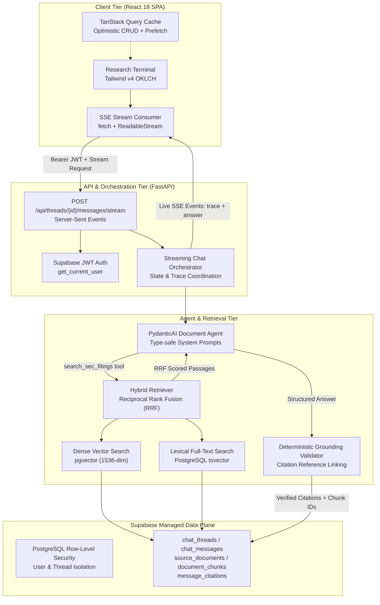

# Document Copilot (DCopilot)

> **Institutional SEC 10-K Research Assistant with Guaranteed Grounding & Verifiable Citations**

Document Copilot is an enterprise-grade AI financial research platform designed for investment analysts at firms like Driftwood Capital. It eliminates the 40+ hours analysts spend every quarterly cycle reading 100+ page SEC 10-K filings by answering complex financial queries with hybrid semantic and lexical retrieval. Every factual metric and assertion is backed by a deterministic Grounding Validator that binds answers directly to verbatim SEC passages and EDGAR accession links, completely eliminating LLM hallucinations.

---

## Architecture



---

## Key Features

- **Hybrid Dense + Lexical Retrieval:** Combines OpenAI dense semantic embeddings (`pgvector` cosine similarity, 1536-dim) with PostgreSQL BM25 full-text indexing (`tsvector`) fused via Reciprocal Rank Fusion (RRF) to eliminate vocabulary mismatch.
- **Deterministic Grounding Validator:** Parses inline `[N]` citation badges, validates them against retrieved SEC text chunks, and links exact chunk UUIDs in `message_citations`. If evidence is missing or a ticker is out-of-corpus, the agent explicitly refuses rather than guessing.
- **Live Agent Activity Trace:** Real-time Server-Sent Events (SSE) stream displaying active status steps (Searching filings → Found N passages → Merging results → Writing answer → Verifying citations) with millisecond-precision timing. Collapses into a compact badge ("Researched in 2.4s · 4 sources") upon completion.
- **Verbatim SEC Excerpt Drawer:** Clicking any inline citation badge or source chip opens an accessible inspection drawer with the exact filing paragraph, CIK, fiscal year, form type, section, RRF score, and a direct link to the SEC EDGAR filing.
- **Enterprise Workspace:**
  - Fast TanStack Query cache with instant revisiting and prefetching on hover/focus.
  - In-memory JWT caching with automatic 401 refresh and retry.
  - Thread search filter, date grouping (Today, Yesterday, Previous 7 Days, Older), and optimistic deletion with a 5-second Undo toast.
  - Export full thread as Markdown with audited citations and verbatim excerpts.
  - Copy response or copy with citations directly to clipboard for investment memos.
  - Global keyboard shortcuts: `⌘K` / `Ctrl+K` for new research thread, `/` to focus composer.
- **Impeccable Visual Design:**
  - Custom typography: Fraunces display serif for headlines, IBM Plex Sans for body, and tabular IBM Plex Mono for financial metrics and tickers.
  - OKLCH color token system with deep slate-tinted neutrals and a single emerald accent ("verified").
  - Dark-first theme with persistent light mode toggle (`localStorage`).
  - Mobile-first responsive fluid layout (320px–1920px), 100dvh, safe-area insets, inputs ≥16px, touch targets ≥44px, and zero horizontal page scroll.
- **Production Containerization:** Multi-stage Nginx Alpine container with Gzip compression, immutable 1-year asset caching (`/assets/*`), explicit no-cache headers for `index.html`, and SPA fallback routing.

---

## SEC 10-K Filings Coverage

| Ticker | Company Name | CIK | Fiscal Period | Parsed Sections |
| :--- | :--- | :--- | :--- | :--- |
| **AAPL** | Apple Inc. | `0000320193` | FY2025 10-K | Items 1, 1A, 7, 7A, 8 |
| **MSFT** | Microsoft Corporation | `0000789019` | FY2024 10-K | Items 1, 1A, 7, 7A, 8 |
| **NVDA** | NVIDIA Corporation | `0001045810` | FY2025 10-K | Items 1, 1A, 7, 7A, 8 |
| **AMZN** | Amazon.com, Inc. | `0001018724` | FY2024 10-K | Items 1, 1A, 7, 7A, 8 |
| **GOOGL** | Alphabet Inc. | `0001652044` | FY2024 10-K | Items 1, 1A, 7, 7A, 8 |

---

## Screenshots & Walkthrough

<!-- Placeholder: Interactive Research Terminal with Live Agent Trace -->
```
+-------------------------------------------------------------------------------------------------------+
| Driftwood Capital Copilot [Verified Grounding Active]                     [Dark/Light] analyst@firm.com|
+------------------------------------+------------------------------------------------------------------+
| [+ New Thread] [Filter threads...] | AAPL Services Segment Net Sales & Gross Margin                   |
| ---------------------------------- | ---------------------------------------------------------------- |
| Today                              | Analyst Query:                                                   |
| > AAPL Services Margin (FY25)      | What were Apple's Services segment net sales in fiscal 2025?     |
| > NVDA Data Center Revenue         |                                                                  |
| Yesterday                          | [*] Researched in 2.3s · 2 sources [v]                           |
| > MSFT vs GOOGL Cloud Growth       | ---------------------------------------------------------------- |
|                                    | In fiscal 2025, Apple reported Services net sales of $96,169M    |
| ⌘K New Thread   / Focus composer   | [1], up 12.9% from $85,200M in FY2024. Services gross margin was |
| AAPL • MSFT • NVDA • AMZN • GOOGL  | 74.2% [2] driven by App Store and Cloud recurring volumes.       |
|                                    |                                                                  |
|                                    | Sources (2): [1] AAPL FY2025 Item 7  [2] AAPL FY2025 Note 2      |
+------------------------------------+------------------------------------------------------------------+
```

---

## Tech Stack

| Layer | Technology | Rationale |
| :--- | :--- | :--- |
| **Backend Framework** | **Python 3.12 + FastAPI** | Native async I/O, Pydantic v2 validation, ASGI streaming response |
| **Package Manager** | **Astral `uv`** | Deterministic lockfile (`uv.lock`), 10-100x faster dependency resolution |
| **Agent Framework** | **PydanticAI** | Type-safe structured LLM orchestration with explicit dependency injection |
| **Database & Vector Store** | **Supabase Postgres + `pgvector`** | Unified data plane: relational data, user auth, JSONB, tsvector, 1536d vectors |
| **Migrations** | **Alembic + SQLAlchemy 2.0** | Version-controlled DDL migrations for vector & tsvector schema objects |
| **Authentication** | **Supabase Auth (JWT Bearer)** | Secure session issuance, token rotation, and PostgreSQL RLS integration |
| **Frontend Framework** | **Vite + React 18 + TypeScript** | Lean Single-Page Application (SPA) with fast HMR and strict typing |
| **Data Fetching & Cache** | **TanStack Query v5** | Server state caching, optimistic updates, request deduplication, and prefetch |
| **Styling & Tokens** | **Tailwind CSS v4** | Modular OKLCH color system, zero-runtime overhead, CSS-only animations |
| **Deployment / Container** | **Docker + Nginx Alpine** | Gzip compression, immutable 1-year asset cache, dynamic `$PORT` envsubst |

---

## Local Development Setup

### 1. Prerequisites

- **Python 3.12+**
- **Astral `uv`** (`curl -LsSf https://astral.sh/uv/install.sh | sh`)
- **Node.js 20+ (LTS)** & **pnpm** (`corepack enable && corepack prepare pnpm@latest --activate`)
- **Docker** (optional, for production container verification)

### 2. Backend Setup

```bash
cd backend

# Install dependencies deterministically
uv sync

# Run database migrations
uv run alembic upgrade head

# Run automated test suite (48 tests passing)
uv run pytest

# Start development server
uv run uvicorn app.main:app --port 8000 --reload
```

### 3. Frontend Setup

```bash
cd frontend

# Install dependencies
pnpm install

# Typecheck and build production bundle
pnpm build

# Start development server
pnpm dev
```

Navigate to `http://localhost:5173`.

### 4. Production Docker Build & Verification

```bash
cd frontend
docker build -t dcopilot-frontend .
docker run -d -p 8080:80 -e PORT=80 dcopilot-frontend

# Verify headers:
curl -I http://localhost:8080/index.html   # Cache-Control: no-cache, no-store, must-revalidate
curl -I http://localhost:8080/app          # 200 OK (SPA fallback)
```

---

## Verification & Test Results

- **Backend Pytest:** 48 passing unit and integration tests (retrieval, RRF fusion, grounding validator, authentication 401, thread CRUD, SSE event order, elapsed_ms, and streaming error recovery).
- **Frontend Typecheck & Build:** `tsc -b && vite build` passing with zero warnings or `any` casts.
- **Initial App JS:** 31.02 kB gzip (target: <150 kB gzip).
- **Landing Page Lazy Chunk:** 6.50 kB gzip.
- **Responsive Layout:** Verified across 320px, 375px, 768px, 1024px, 1440px viewports with touch targets ≥44px and inputs ≥16px.
- **Nginx Caching:** Immutable 1-year cache headers for `/assets/*`, strict no-cache for `index.html`.

---

## License

Demo project built for institutional SEC filing research. Data sourced from public SEC EDGAR filings. Not investment advice.
