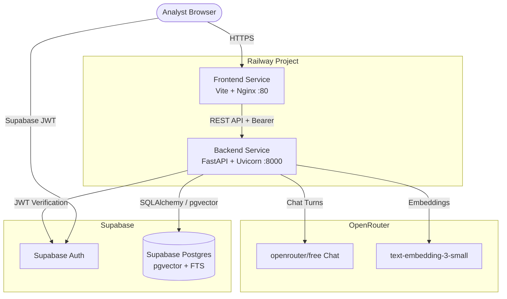

# Railway Deployment Runbook — Document Copilot

This guide outlines how to deploy the **Document Copilot** full-stack application (FastAPI backend + React SPA frontend) to [Railway](https://railway.app) backed by hosted Supabase Postgres and OpenRouter.

---

## 1. Architecture Overview on Railway



---

## 2. Backend Service Deployment

1. **Create Service in Railway:**
   - In your Railway project, click **+ New** &rarr; **GitHub Repo**.
   - Select your `document-copilot` repository.
   - Set **Root Directory** to `/backend`.
   - Railway will automatically detect the [backend/Dockerfile](file:///Users/abhisuryawanshi/DCopilot/backend/Dockerfile).

2. **Configure Environment Variables:**
   Under the service's **Variables** tab, set:

   | Variable | Value | Notes |
   |---|---|---|
   | `DATABASE_URL` | `postgresql://postgres:<password>@db.<ref>.supabase.co:5432/postgres` | **Direct session string** (Port 5432), not the transaction pooler |
   | `SUPABASE_URL` | `https://<ref>.supabase.co` | Supabase project URL |
   | `SUPABASE_ANON_KEY` | `sb_publishable_...` | Supabase anon/public key |
   | `SUPABASE_SERVICE_ROLE_KEY` | `eyJ...` | Supabase service-role secret |
   | `OPENAI_API_KEY` | `sk-or-v1-...` | OpenRouter API Key |
   | `OPENAI_BASE_URL` | `https://openrouter.ai/api/v1` | OpenRouter OpenAI-compatible endpoint |
   | `OPENAI_CHAT_MODEL` | `openrouter/free` | Auto-routed free chat model |
   | `OPENAI_EMBEDDING_MODEL` | `openai/text-embedding-3-small` | 1536-dim vector embeddings |
   | `OPENAI_EMBEDDING_DIMENSIONS` | `1536` | Must match pgvector column |
   | `ALLOWED_ORIGINS` | `https://<your-frontend>.up.railway.app` | Comma-separated CORS allowed origins |

3. **Configure Healthcheck:**
   - **Healthcheck Path:** `/health`
   - **Healthcheck Timeout:** `300`

4. **Verify Boot:**
   - The container startup command automatically applies database migrations:
     ```bash
     uv run alembic upgrade head && uv run uvicorn app.main:app --host 0.0.0.0 --port ${PORT:-8000}
     ```
   - Test by visiting `https://<your-backend>.up.railway.app/health` &rarr; returns `{"status": "ok"}`.

---

## 3. Frontend Service Deployment

1. **Create Service in Railway:**
   - In the same project, click **+ New** &rarr; **GitHub Repo**.
   - Select the same repository.
   - Set **Root Directory** to `/frontend`.
   - Railway detects [frontend/Dockerfile](file:///Users/abhisuryawanshi/DCopilot/frontend/Dockerfile).

2. **Configure Build Arguments / Environment Variables:**
   Vite SPAs bake environment variables during `pnpm build`. Under **Variables**, add:

   | Variable | Value |
   |---|---|
   | `VITE_API_BASE_URL` | `https://<your-backend>.up.railway.app` |
   | `VITE_SUPABASE_URL` | `https://<ref>.supabase.co` |
   | `VITE_SUPABASE_ANON_KEY` | `sb_publishable_...` |

3. **Configure Healthcheck:**
   - **Healthcheck Path:** `/health`
   - **Port:** Railway dynamically assigns `PORT`, which [nginx.conf.template](file:///Users/abhisuryawanshi/DCopilot/frontend/nginx.conf.template) listens on.

---

## 4. Ingesting Corpus on Hosted Database

You can run corpus ingestion directly from your local terminal targeting the remote Supabase database:

```bash
cd backend

# Ingest representative filings:
uv run ingest/ingest_corpus.py --ticker AAPL --limit 1
uv run ingest/ingest_corpus.py --ticker MSFT --limit 1
uv run ingest/ingest_corpus.py --ticker NVDA --limit 1

# Or ingest the full 25-filing corpus:
uv run ingest/ingest_corpus.py
```

Because `DATABASE_URL` in `backend/.env` points to the hosted Supabase database, all chunks and HNSW vectors are saved directly to production.

---

## 5. Post-Deployment Verification Checklist

- [ ] Backend health probe: `GET /health` &rarr; HTTP 200 `{"status": "ok"}`.
- [ ] Database connectivity: `GET /api/threads` returns HTTP 401 without token (RLS & auth active).
- [ ] Frontend static routing: Direct navigation to `/auth` loads without 404s (Nginx SPA fallback working).
- [ ] Analyst Authentication: Register or sign in with email via Supabase Auth.
- [ ] Grounded Chat Turn: Send query *"What was Apple's total net sales in fiscal 2025?"* &rarr; returns answer with bracketed citations `[1]`.
- [ ] Citation Drawer: Click `[1]` badge &rarr; inspect verbatim SEC filing excerpt and EDGAR link.
